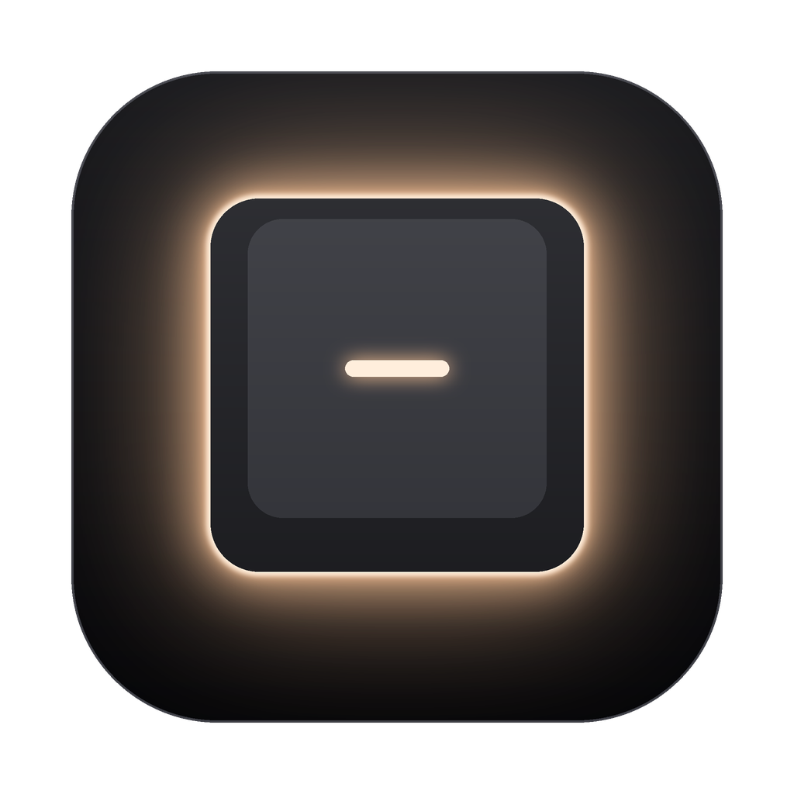
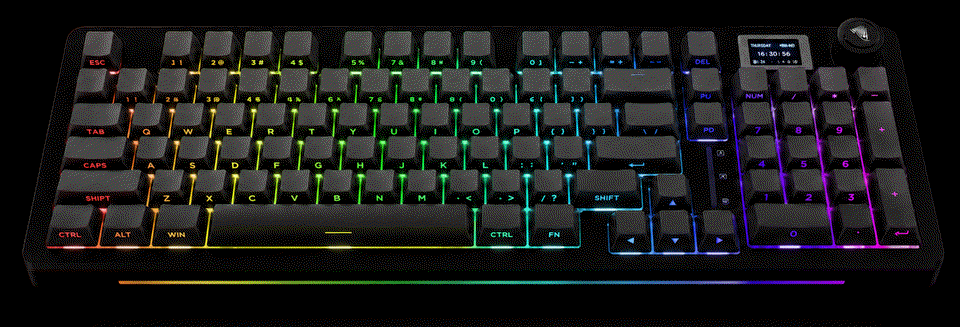
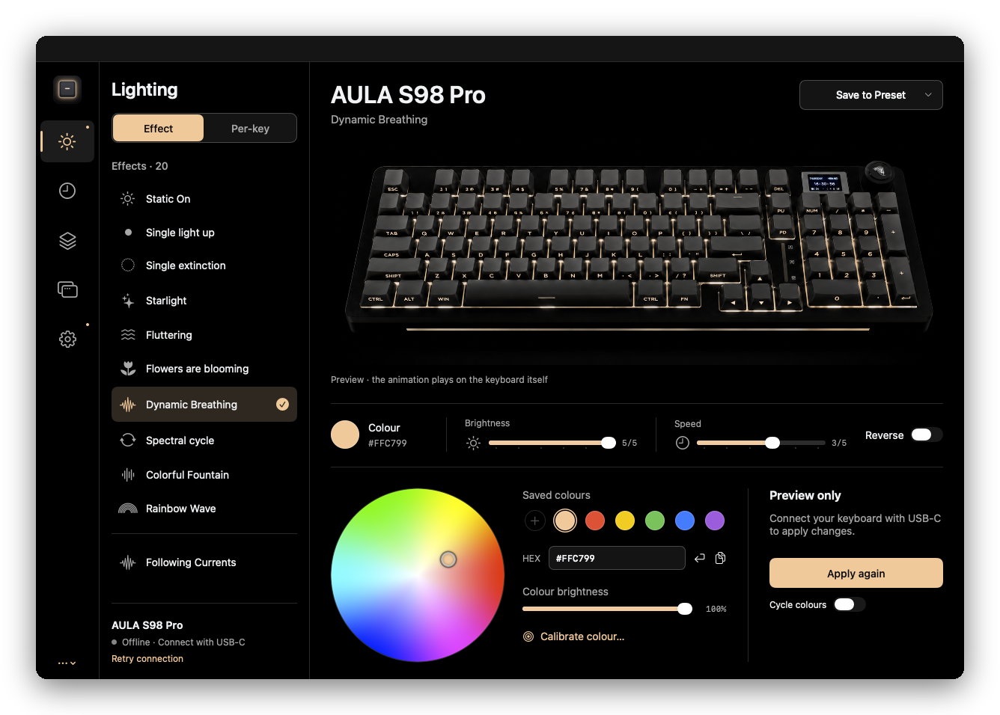
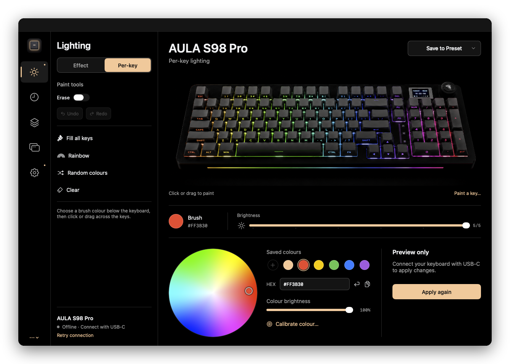
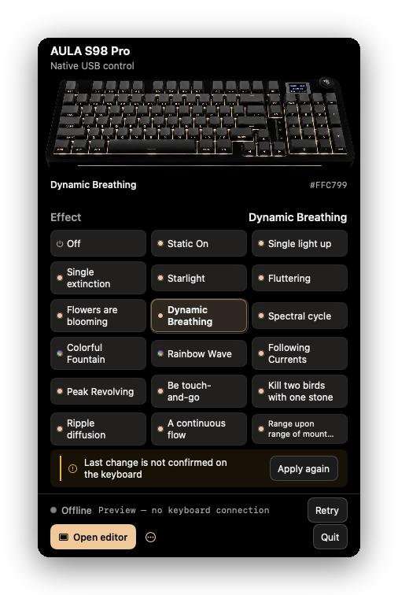
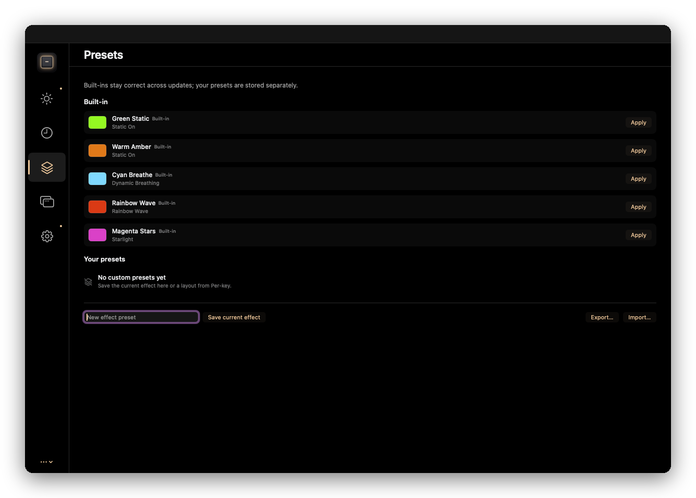
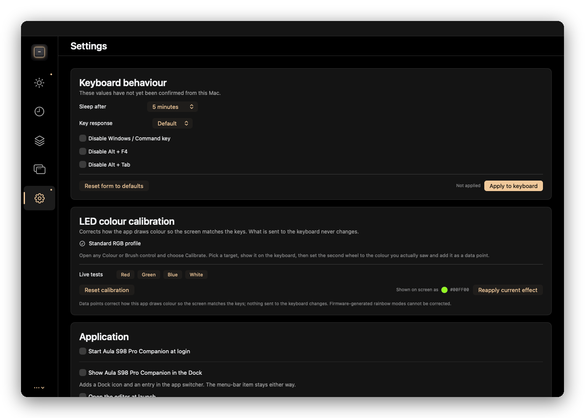

<div align="center">



# Aula S98 Pro Companion

**The Mac app AULA never made.**<br>
Lighting, per-key colour, the keyboard's clock, and presets for the AULA S98 Pro, native on macOS.

[](https://github.com/Lawsinex/aula-s98-pro-companion-macos/actions/workflows/verify.yml)
[](https://github.com/Lawsinex/aula-s98-pro-companion-macos/releases/latest)
[](LICENSE)


[**Download**](https://github.com/Lawsinex/aula-s98-pro-companion-macos/releases/latest) · [**Paint the keyboard in your browser**](https://lawsinex.github.io/aula-s98-pro-companion-macos/) · [Protocol notes](docs/PROTOCOL.md)



<sub>**Unofficial.** A community project, not made by, affiliated with, or endorsed by AULA.</sub>

</div>

## Why it exists

AULA's software for the S98 Pro is Windows-only, and its web driver has no entry for this model. On a Mac, that meant a whole virtual machine just to change a colour.

This replaces that with one small menu-bar app. It talks straight to the keyboard over USB.

- **Native:** Swift and SwiftUI, about 6.5 MB, with no runtime dependencies.
- **Private:** no account, no telemetry, no network calls.
- **Honest:** it tells you when a change didn't reach the keyboard, rather than showing success.

## What it does



| | |
|---|---|
| **20 lighting modes** | Pick an effect (19 plus Off), then set its colour, brightness, speed, direction and colour cycling. |
| **Per-key painting** | Click or drag across all 96 keys, with undo, redo, fill, rainbow, random and gradients. |
| **Live preview** | A photo-like keyboard re-lit per key, so you see your colours before you commit them. |
| **Keyboard clock** | Fixes the date on the keyboard's screen, then keeps it in sync at launch, every 30 minutes and after wake. |
| **Presets** | Save, apply, rename, import and export effects and per-key layouts. |
| **Per-app lighting** | Bind a preset to an app and the lighting follows you as you switch. Off by default. |
| **Colour calibration** | Teach the app how your LEDs really look, so the screen matches the keys. [How it works](docs/CALIBRATION.md) |
| **Keyboard settings** | Sleep timeout, key response, and disabling the Win key, Alt+F4 and Alt+Tab. |
| **Command line** | A 36 KB `aula-s98` tool for scripts and shortcuts. |

<table>
<tr>
<td width="62%"></td>
<td></td>
</tr>
<tr>
<td align="center"><sub>Paint any key</sub></td>
<td align="center"><sub>Quick controls in the menu bar</sub></td>
</tr>
<tr>
<td></td>
<td></td>
</tr>
<tr>
<td align="center"><sub>Presets</sub></td>
<td align="center"><sub>Settings</sub></td>
</tr>
</table>

## Install

You need an **Apple silicon Mac on macOS 13 or newer**, and the keyboard connected **by USB cable**.

### Download

1. Download the zip from the [latest release](https://github.com/Lawsinex/aula-s98-pro-companion-macos/releases/latest), and unzip it.
2. Drag **Aula S98 Pro Companion** to Applications.
3. Open it. macOS will refuse the first time, because this free project isn't notarized by Apple.
4. Go to **System Settings › Privacy & Security**, scroll down, and choose **Open Anyway**.

It then lives in your menu bar as a small keyboard icon. Clicking the app in Finder or Spotlight opens the full editor, and Settings can also show it in the Dock.

### Build it yourself

You need Xcode's command line tools, plus `numpy` and `Pillow` for the preview:

```bash
git clone https://github.com/Lawsinex/aula-s98-pro-companion-macos.git
cd aula-s98-pro-companion-macos
python3 -m pip install numpy pillow
./scripts/install.sh    # installs to ~/Applications and ~/bin
```

## Command line

```bash
aula-s98 set 1 -c 00ff00           # solid green
aula-s98 set breathing -c ff00ff   # effect by name
aula-s98 set "rainbow wave" -s 5   # fast rainbow wave
aula-s98 perkey rainbow -b 4       # per-key rainbow at brightness 4
aula-s98 off
aula-s98 list                      # every effect
```

Options: `-c RRGGBB`, `-b 0-5` (brightness), `-s 0-5` (speed), `-d 0|1` (direction), `--colorful`, `-v` (packet trace). The app and the tool share a lock, so they can't talk over each other. The tool sends raw colours and ignores the app's calibration.

## What it can't do

- **Wired only.** In 2.4 GHz mode the dongle appears as a different device, and Bluetooth doesn't expose the settings channel.
- **The front light strip stays out of reach.** The firmware has no USB route to it, so use the keyboard's own `Fn` shortcuts. [The evidence](docs/PROTOCOL.md#the-front-light-strip)
- **No pictures on the keyboard's screen, on purpose.** Sending one hangs the keyboard, and AULA's own Windows driver does the same.
- **No macros or key remapping** yet.
- **The animated effects play on the keyboard,** not in the preview, because the firmware draws them itself.
- **The preview's printed legends are imperfect.** Its frames are AI-generated, so some legends are wrong, such as `SHIPT`. Clicks still land on the right LED. [Details](docs/PREVIEW.md#what-the-preview-cannot-do)
- **Tested on one keyboard.** Other firmware versions might behave differently. A report helps if yours does.

## Use at your own risk

This app writes to your keyboard using a protocol AULA doesn't document, and those writes reach the keyboard's flash storage. It has been used on one real S98 Pro without damage, but there is no guarantee for yours, and using unofficial software may affect your warranty. The [MIT licence](LICENSE) provides it with no warranty.

## For developers

```bash
./scripts/verify.sh   # compilers, logic tests, CLI checks, render and preview gates
./scripts/build.sh    # builds into build/release
```

No Xcode project and no packages: just `swiftc`, `clang` and system frameworks. The keyboard's protocol is in [`src/AulaDevice.swift`](src/AulaDevice.swift), and the command-line tool is one C file, [`src/aula-s98.c`](src/aula-s98.c).

- [**Protocol notes**](docs/PROTOCOL.md): the USB commands, the firmware's memory map, and every gotcha
- [**How the preview works**](docs/PREVIEW.md): turning four images into a per-key relightable keyboard
- [**Contributing**](CONTRIBUTING.md): read the hardware safety rule first

## Licence and trademarks

The code, documentation and original artwork here are released under the [MIT licence](LICENSE).

AULA and S98 Pro are trademarks of their respective owner, and the name appears here only to say which keyboard this works with. The licence grants no rights to them. AULA's logo isn't used as this app's branding, but the keyboard in the preview images carries an approximation of a maker's mark on its knob and screen, as the real product does.

The four reference images in `viewer/reference/` are AI-generated pictures of the keyboard, not photographs. The key layout, command values and effect names are facts about the keyboard, needed to work with it. No AULA code or binaries are included.
